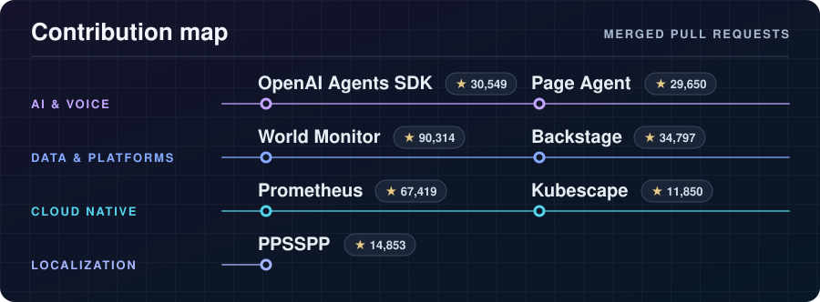

 

**Software engineer and open-source contributor.** I build APIs and data pipelines and improve AI agent reliability.

 

**Accepted into OpenAI’s [Codex for Open Source](https://developers.openai.com/community) program (2026)**

**Invited to the GitHub Maintainer Advisory Network**

 

<picture>
  <source media="(prefers-color-scheme: dark)" srcset="assets/section-upstream-dark.svg">
  
</picture>

| Route | Merged PRs by project |
| :-- | :-- |
| **AI & voice** | [OpenAI Agents SDK](https://github.com/openai/openai-agents-python/pulls?q=is%3Apr+is%3Amerged+author%3AFayezBast) · [Page Agent](https://github.com/alibaba/page-agent/pulls?q=is%3Apr+is%3Amerged+author%3AFayezBast) |
| **Data & platforms** | [World Monitor](https://github.com/koala73/worldmonitor/pulls?q=is%3Apr+is%3Amerged+author%3AFayezBast) · [Backstage](https://github.com/backstage/backstage/pulls?q=is%3Apr+is%3Amerged+author%3AFayezBast) |
| **Cloud native** | [Prometheus](https://github.com/prometheus/prometheus/pulls?q=is%3Apr+is%3Amerged+author%3AFayezBast) · [Kubescape](https://github.com/kubescape/kubescape/pulls?q=is%3Apr+is%3Amerged+author%3AFayezBast) |
| **Localization** | [PPSSPP](https://github.com/hrydgard/ppsspp/pulls?q=is%3Apr+is%3Amerged+author%3AFayezBast) |

### Featured contributions

- **OpenAI Agents SDK** — Fixed real-time voice transcription by converting streamed float32 audio to PCM16. [PR #3916](https://github.com/openai/openai-agents-python/pull/3916)
- **Kubescape** — Prevented autofix from patching the wrong Kubernetes resource when a manifest changed after scanning. [PR #4625](https://github.com/kubescape/kubescape/pull/4625)
- **World Monitor** — Added cancellation safeguards and checked that browser agent actions took effect before reporting success. [PR #7050](https://github.com/koala73/worldmonitor/pull/7050)
- **World Monitor** — Built the ocean and ice data pipeline, from ingestion through the RPC, caching, and freshness checks. [PR #2652](https://github.com/koala73/worldmonitor/pull/2652)
- **Alibaba Page Agent** — Fixed a crash in downstream bundles that strip debug logging during minification. [PR #623](https://github.com/alibaba/page-agent/pull/623)

<strong>Full contribution index</strong>

41 public PRs merged across 7 upstream repositories as of November 7, 2026.

| Repository | Merged PRs |
| :-- | --: |
| [koala73/worldmonitor](https://github.com/koala73/worldmonitor) | 33 |
| [kubescape/kubescape](https://github.com/kubescape/kubescape) | 2 |
| [prometheus/prometheus](https://github.com/prometheus/prometheus) | 2 |
| [alibaba/page-agent](https://github.com/alibaba/page-agent) | 1 |
| [backstage/backstage](https://github.com/backstage/backstage) | 1 |
| [hrydgard/ppsspp](https://github.com/hrydgard/ppsspp) | 1 |
| [openai/openai-agents-python](https://github.com/openai/openai-agents-python) | 1 |

[View all public merged PRs on GitHub](https://github.com/search?q=is%3Apr+is%3Amerged+is%3Apublic+author%3AFayezBast&type=pullrequests)

